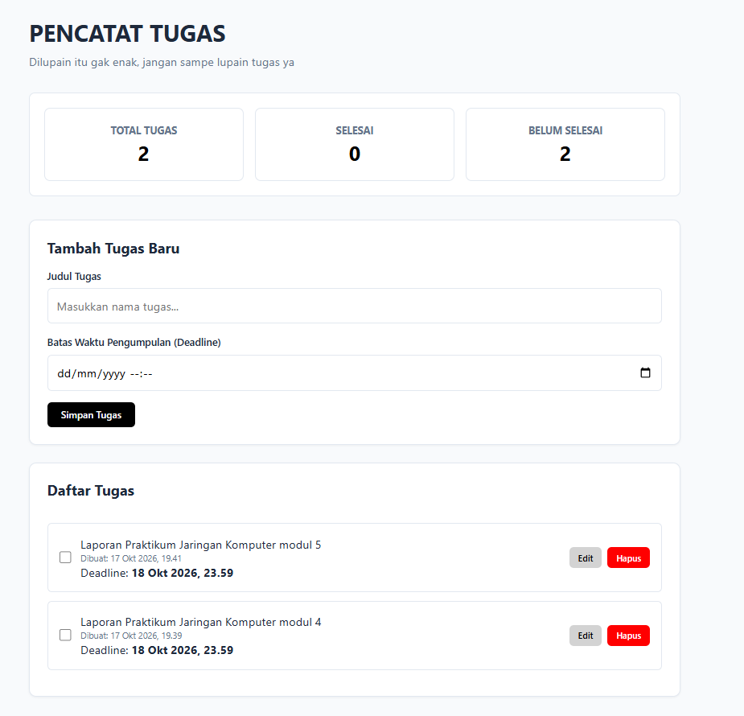
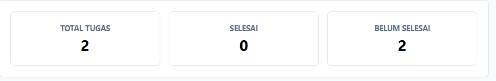
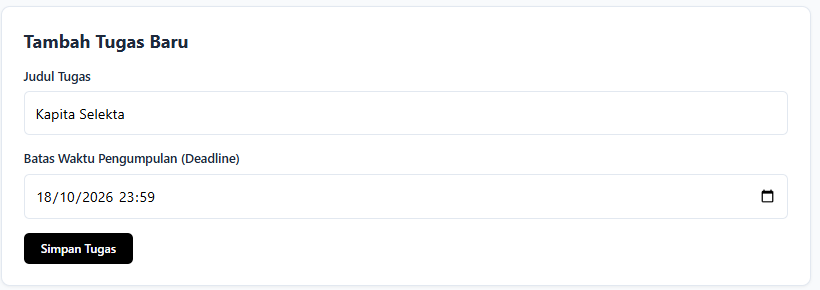
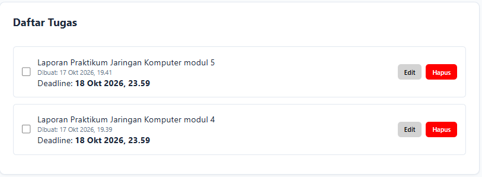

# Tugas PRAKTIKUM 2

# Identitas
- Nama:  Dimas Alhamdy
- NIM:   124140165
- KELAS: RB

# Deskripsi Aplikasi
Aplikasi ini merupakan penerapan next gen js dengan menggunakan pencatatan tugas sederhana sebagai implementasi

# Fitur
Fitur yang dimiliki oleh website ini adalah
- [X] Daftar Status Tugas
    - Terdapat pencatat jumlah tugas dan status sebuah tugas apakah jika sudah diselesaikan atau belum.
- [x] Menambahkan Tugas 
    - Terdapat form untuk menambahkan tugas dengan menuliskan Judul Tugas.
- [x] Menambahkan Tenggat waktu
    - Terdapat form untuk menuliskan tenggat waktu.
- [x] Daftar Tugas
    - Setelah judul tugas dan tenggat waktu ditambahkan maka daftar tugas akan ditampilkan dalam bentuk list.
- [x] Tombol selesai
    - Apabila tugas telah selesai maka terdapat tombol yang dapat langsung mencoret judul tugas.
- [X] Tombol Edit
    - Apabila terdapat kesalahan maupun perubahan baik pada judul atau tenggat maka terdapat tombol edit untuk melakukan perubahan.
- [X] Tombol Hapus
    - Apabila Tugas Telah dikerjakan dan ingin dihapuskan untuk memudahkan membaca tugas baru maka terdapat tombol hapus untuk melakukan hal tersebut.

# Panduan Pakai
 1. Pasikan Anda memiliki semua folder dan file yang dibutuhkan 
 2. Pastikan Anda mempunyai Extension Live Server
    Jika anda tidak mempunyainya 
        1. cari tab Extension pada sebelah kiri panel
        2. Lalu cari Extension Live Server
        3. Klik Install
        4. Setelah terpasang, klik kanan pada file index.html
        5. Pilih Open With Live Server, maka browser akan otomatis terbuka

# Screenshot Tampilan
1. Tampilan Utama

2. Tampilan Status Tugas

3. Tampilan Form Tambah Tugas dan Deadline

4. Tampilan Daftar Tugas
