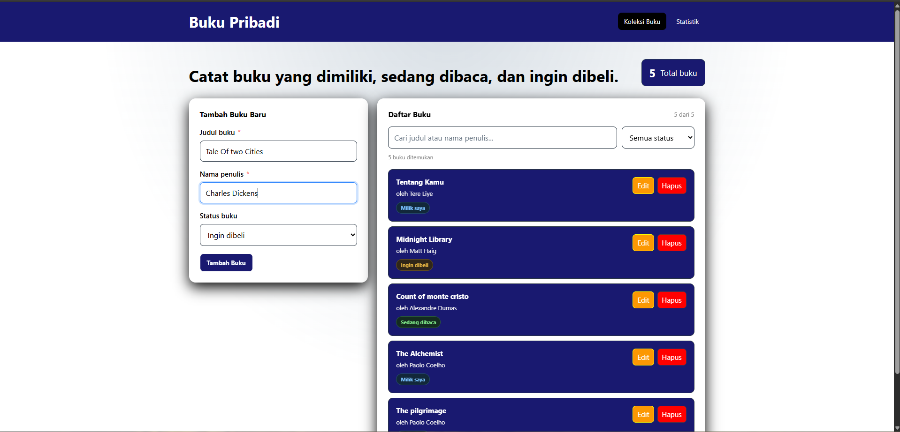
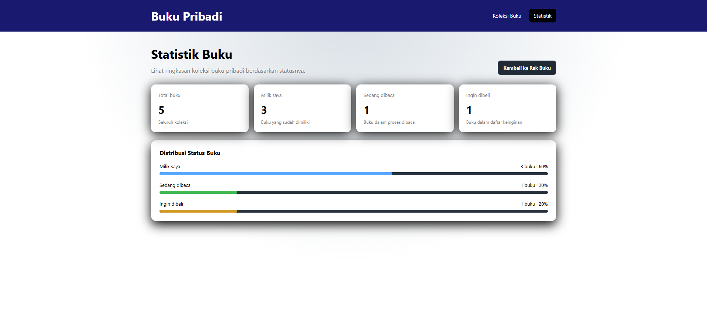
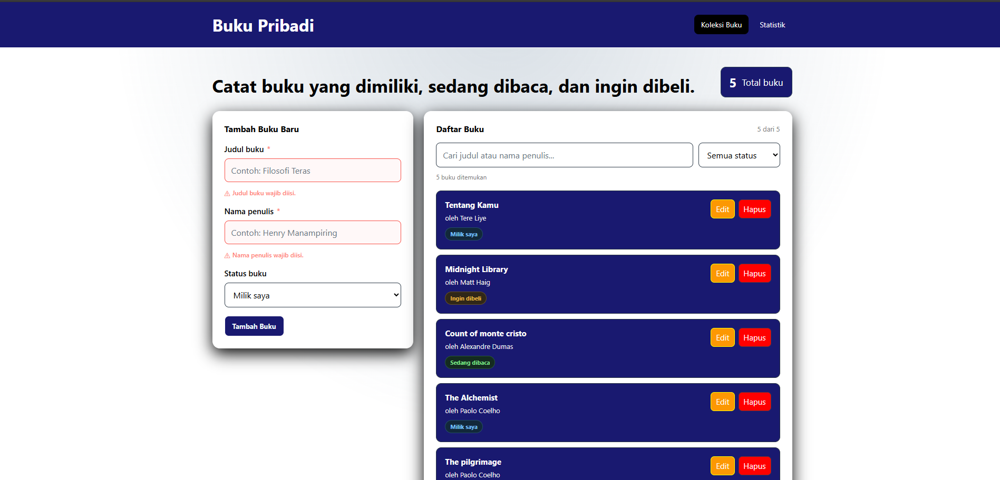
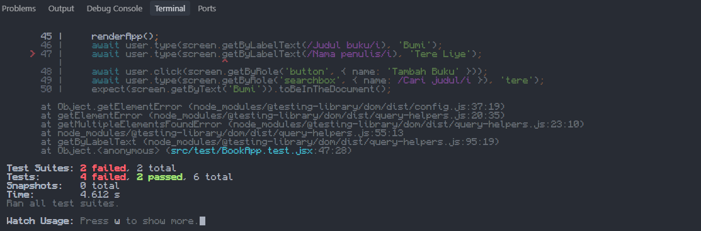

# Aplikasi Manajemen Buku Pribadi (Create React App)
Aplikasi untuk mengurus dan mengorganisir buku. Dibantu dengan mencatat, memantau dan mengelola koleksi pribadi secara teratur

## Menjalankan Proyek
1. Persiapkan Node.js(versi terbaru), diperiksa melalui node --version & npm --version
2. Pindah ke directory project.
3. Jalankan `npm install`.
4. Jalankan `npm start` untuk membuka aplikasi di mode pengembangan (`http://localhost:3000`).

## Screenshots
1. Tampilan utama

2. Tampilan Statistik

3. Validasi Error

4. Hasil-Testing

## Fitur React yang Digunakan
- **React Hooks Inti**
  - `useState`: Mengelola *state* lokal seperti nilai input form, pesan kesalahan (*errors*), status *touched*, pencarian, dan pilihan filter
  - `useEffect`: Menangani *side effect* untuk menyinkronkan data ke `localStorage` dan memperbarui formulir saat masuk ke mode edit.
  - `useMemo`: Mengoptimalkan performa dengan memetakan kalkulasi statistik dan hasil pemfilteran buku agar tidak dihitung ulang secara tidak perlu.
  - `useContext`: Membaca dan mengonsumsi data *state global* dari `BookContext` secara langsung di dalam komponen.

- **Custom Hooks (Hook Buatan)**
  - `useLocalStorage`: Mengabstraksi pembacaan dan penulisan data secara otomatis ke `window.localStorage`
  - `useBookStats`: Menghitung kalkulasi data agregat (total buku, status milik, sedang dibaca, dan ingin dibeli).
  - `useBooks`: Mempermudah akses ke fungsi-fungsi `BookContext`.

- **Context API (`createContext` & `Provider`)**
  - Mengelola *state global* untuk data buku dan fungsi pencatatan (tambah, edit, hapus) tanpa perlu melakukan *prop drilling*.

- **Controlled Components (Komponen Terkontrol)**
  - Menangani seluruh elemen formulir (`<input>` dan `<select>`) dengan *state* React sebagai satu-satunya sumber kebenaran (*single source of truth*).

- **PropTypes (Validasi Props)**
  - Memastikan pemeriksaan tipe data *props* pada komponen (`PropTypes.shape`, `PropTypes.func`, `PropTypes.arrayOf`, dll.) untuk menjaga kestabilan aplikasi.

- **Integrasi React Router DOM**
  - Memanfaatkan `BrowserRouter`, `Routes`, `Route`, `NavLink`, dan `Navigate` untuk navigasi antarhalaman (*Single Page Application*).