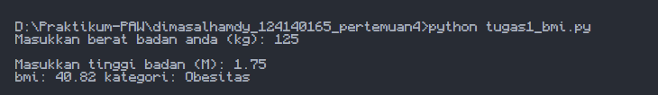
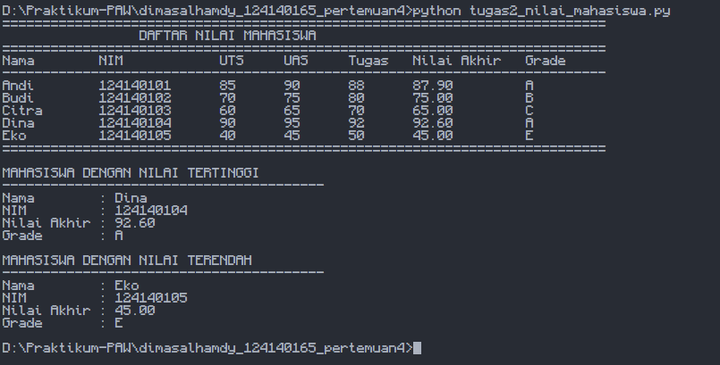
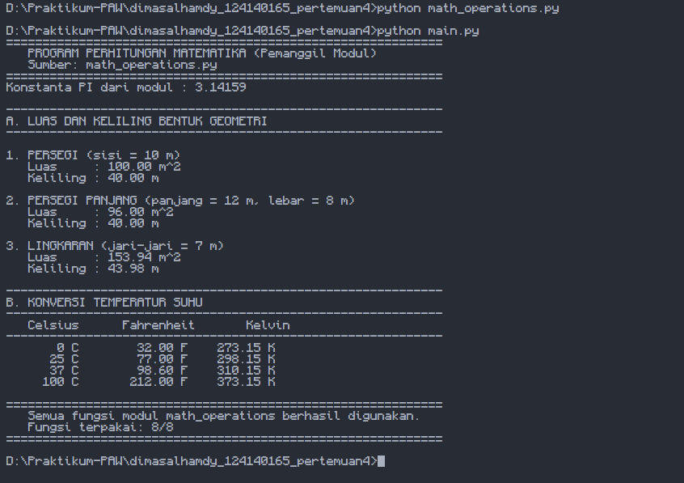

## Identitas Diri
Nama: Dimas Alhamdy  
NIM: 124140165

## Alur Kerja dan fungsi

Deskripsi singkat alur kerja dan fungsi pada setiap program tugas.

1. `tugas1_bmi.py` — Penghitung BMI
- **Alur:** program meminta untuk input berat badan (kg) dan tinggi badan (m) kemudian dihitung `BMI = berat / (tinggi * tinggi)` lalu kategori ditentukan memakai `if-elif-else` yang kemudian program mencetak nilai BMI beserta kategori.
- **Fungsi:** menampilkan status berat badan: kurang (`< 18.5`), normal (`18.5–24.9`), berlebih (`25–29.9`), obesitas (`≥ 30`).

2. `tugas2_nilai_mahasiswa.py` — Daftar Nilai Mahasiswa
- **Alur:** data 5 mahasiswa (list berisi dictionary) kemudian hitung nilai akhir (UTS 30% + UAS 40% + Tugas 30%) ditentukan grade A–E hasilnya disimpan ke dictionary dan dicetak tabel nilai, program cari nilai tertinggi dan terendah.
- **Fungsi:** memproses dan menampilkan rekap nilai seluruh mahasiswa secara rapi dalam bentuk tabel.

3. `math_operations.py` + `main.py` — Modul Matematika
- **`math_operations.py` (modul):** berisi konstanta `PI`, fungsi luas & keliling (persegi, persegi panjang, lingkaran), dan konversi suhu (Celsius ke Fahrenheit, Celsius ke Kelvin).
- **`main.py` (program utama):** mengimpor modul dengan 2 cara (`import math_operations` dan `from math_operations import ...`), menjalankan seluruh fungsi dengan berbagai nilai uji, lalu mencetak hasil perhitungan secara terstruktur.

## Cara Menjalankan

1. Pastikan sudah memiliki python versi terbaru pada perangkat anda
2. Clone repository github pada vscode
3. pada terminal vscode ketike `cd dimasalhamdy_124140165_pertemuan4`
4. setelah pindah ke directory ketik `python [nama_file].py`

## Screenshots

1. Hasil tugas1_bmi.py

2. Hasil tugas2_nilai_mahasiswa.py

3. Hasil main.py

