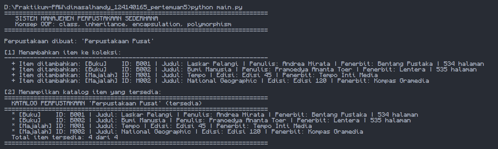
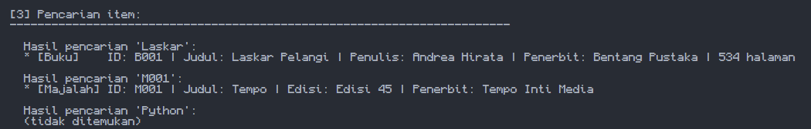
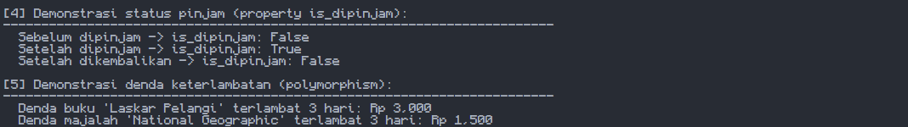

## Identitas Diri
Nama: Dimas Alhamdy  
NIM: 124140165

## Alur Kerja dan fungsi

Deskripsi singkat alur kerja dan fungsi pada setiap program tugas.

1. `library_item.py` — Definisi Item Perpustakaan
- **Alur:** mendefinisikan abstract class `LibraryItem(ABC)` sebagai kelas dasar yang memiliki atribut privat `__id` dan `__dipinjam`, atribut terlindungi `_judul` dan `_penerbit`, serta dua abstract method `get_detail()` dan `hitung_denda()`. Dari kelas ini diturunkan subclass `Book` (menambah `_penulis` dan `_jumlah_halaman`) dan `Magazine` (menambah `_edisi`).
- **Fungsi:** menjadi cetak biru semua item perpustakaan sekaligus menyimpan status pinjam melalui property `is_dipinjam`.
- **Konsep OOP:** abstract class, abstract method, inheritance, encapsulation, polymorphism, dan property.

2. `library.py` — Pengelola Koleksi Perpustakaan
- **Alur:** kelas `Library` menyimpan seluruh item pada atribut privat `__koleksi`. Metode `tambah_item()` menambahkan item, `tampilkan_katalog()` mencetak item yang tersedia (tidak sedang dipinjam), dan `cari()` mencari item berdasarkan judul atau id.
- **Fungsi:** mengelola koleksi perpustakaan secara terpusat dan menyembunyikan struktur data internal dari luar kelas.
- **Konsep OOP:** class dan encapsulation (atribut privat `__koleksi` dan `__nama`).

3. `main.py` — Program Utama
- **Alur:** membuat objek `Library`, menambahkan 2 `Book` dan 2 `Magazine`, menampilkan katalog, mencari item berdasarkan judul (`Laskar`), id (`M001`), dan kasus tidak ditemukan (`Python`), mengubah status pinjam lewat property `is_dipinjam`, menghitung denda keterlambatan, lalu menampilkan katalog akhir.
- **Fungsi:** menguji dan mendemonstrasikan seluruh fungsionalitas sistem perpustakaan.
- **Konsep OOP:** memanfaatkan inheritance, polymorphism, dan encapsulation yang telah dibuat pada modul lain.

## Cara Menjalankan

1. Pastikan sudah memiliki python versi terbaru pada perangkat anda
2. Clone repository github pada vscode
3. pada terminal vscode ketik `cd dimasalhamdy_124140165_pertemuan5`
4. setelah pindah ke directory ketik `python main.py`

## Screenshots

1. Tampilan Menambahkan buku dan katalog buku

2. Tampilan Pencarian buku

3. Tampilan peminjaman buku dan denda keterlambatan

4. Tampilan Katalog Akhir
